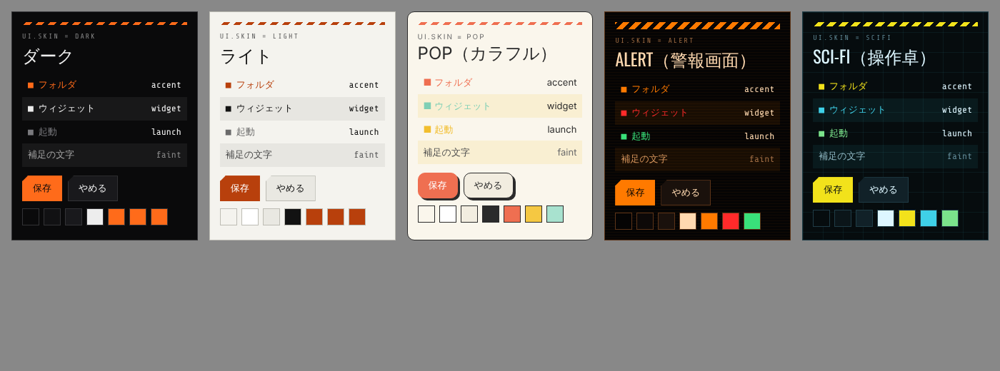

# デザインガイドライン

Theta Hatch シリーズの見た目は **Theta.Home.Hatch のスキン**に揃えます。
利用者が Home で選んだスキンを、ほかのアプリも同じように使えるようにするのが目標です。

## 1. スキン

| `ui.skin` | 名前 | 見た目 |
| --- | --- | --- |
| `system` | 端末に合わせる（既定） | 端末がダークなら `dark`、ライトなら `light` |
| `dark` | ダーク | 計器盤（HUD）風：黒地にオレンジ 1 色、細い線、四角い角 |
| `light` | ライト | 紙のような地に墨色の文字、濃いめのオレンジ |
| `pop` | POP（カラフル） | クリームの地に墨色の太い線、コーラル・イエロー・ミント。角丸と右下の影、ゴシック体 |
| `alert` | ALERT（警報画面） | 黒地に橙の文字、警告の赤・正常の緑。太い警告の帯、走査線 |
| `scifi` | SCI-FI（操作卓） | 黒に近い青緑の地に方眼、黄・水色・緑 |

色の値はすべて [`skins/skins.json`](skins/skins.json) にあります（**これが正本**）。

| ファイル | 使うアプリ |
| --- | --- |
| [`skins/skins.json`](skins/skins.json) | 正本。どの言語からでも読める。AI への指示にも |
| [`skins/theta-skins.css`](skins/theta-skins.css) | WebView・Web 版（Meishi・Mensetsu・Oekaki など HTML の UI）。`<html data-theta-skin="pop">` で切り替え |
| [`skins/ThetaSkins.kt`](skins/ThetaSkins.kt) | Jetpack Compose（Home・KidsHome など）。`paletteFor(skin, isSystemInDarkTheme())` |
| [`skins/preview.html`](skins/preview.html) | 5 つを並べた見本 |
| [`hud-kit/`](hud-kit/README.md) | Home 0.15 時点の部品一式（Compose の部品・View の res・CSS・書体と OFL ライセンス）。ダーク／ライトの HUD の作り方はここが詳しい |

CSS と Kotlin は生成ファイルです。色を変えるときは `skins.json` を直して `python tools/gen_skins.py`。

## 2. 共通の決まり

1. **色の役割を守る**：地（bg・panel・raised）、文字の 3 段（fg・muted・faint）、線（line）、主な色（accent）。accent は「選んでいる」「主な操作」「問題がある」ところだけ
2. **3 つの群の色**：フォルダ＝accent、ウィジェット・予定など＝widget、起動＝launch（POP・ALERT・SCI-FI で色分けされる）
3. **形**：POP 以外は角を丸めない（ボタン・入力欄だけ左上を 8dp 落とす）、線は 1dp。POP は角 10dp、線 1.5dp、ボタンに右下の影
4. **書体**：見出し・時計は Oswald、ラベル・数字・ボタンは Share Tech Mono、日本語は端末の書体。POP はすべて端末のゴシック
5. **英字の小さなラベル**（`SYS.TIME`、`[ LIST ]`）を見出しに添える。大文字・字間広め・faint
6. **一覧は縞模様**（zebra を奇数行に）。行の間に隙間を作らない
7. **飾り**：ALERT は走査線と太い警告の帯、SCI-FI は方眼（`backdrop`・`hazard`）
8. 書体を同梱するときは `hud-kit/licenses/` の OFL も一緒に入れる

## 3. 各アプリの対応のしかた

1. 設定に「スキン」（system・dark・light・pop・alert・scifi）を置く。既定は `system`
2. 値はシリーズの設定 `ui.skin`（`spec/THETA_SHARED_SETTINGS.md`）として Vault の `.theta/settings.json` に書く。「シリーズに合わせる」なら、Home などほかのアプリで変えたスキンがそのまま届く
3. 画面の色は直接書かず、必ず役割（`--accent`、`p.accent` など）から取る
4. 5 つのスキンすべてで、文字が読めること・横にはみ出さないことを確かめる（`preview.html` と見比べる）

> Android の同じ端末の中で、Home がいま選んでいるスキンを Vault を待たずに知りたい場合は、`spec/THETA_SHARED_SETTINGS.md` §4 の `ContentProvider`（同じ署名鍵のアプリ同士）で `info` に `ui.skin` を足す形を想定しています（未実装）。
