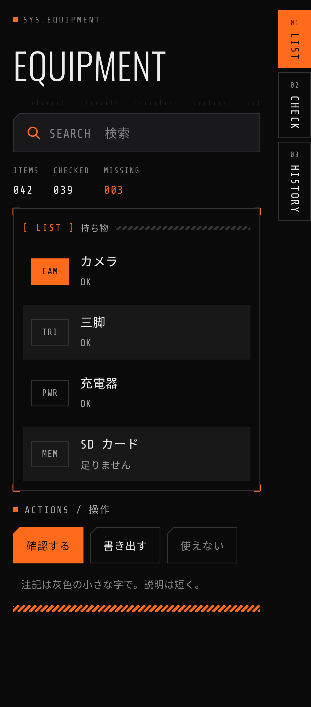
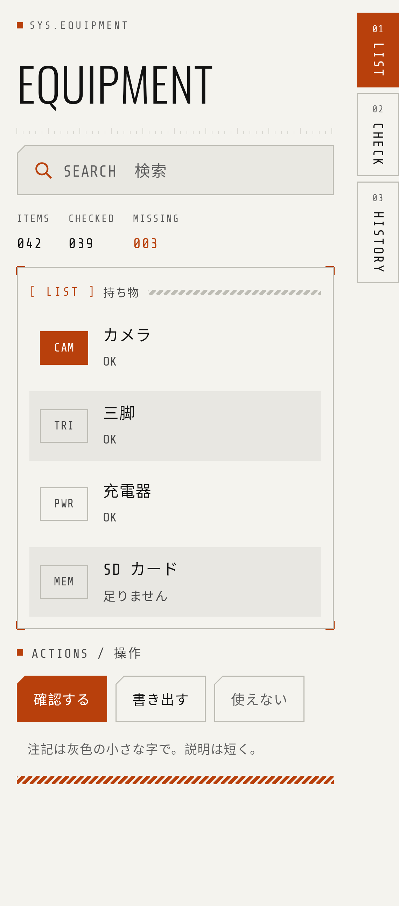
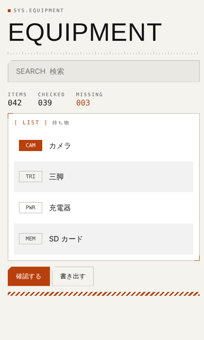

# Theta Hatch HUD デザインキット

Theta Home Hatch（0.15.0-alpha）の見た目を、ほかの Theta Hatch シリーズに持っていくための一式です。
**計器盤（HUD）風**：黒地にオレンジ 1 色、細い線、四角い角。ライト（紙のような地に墨色）も同じ規則でそろえています。

| ダーク | ライト | Web 版 |
| --- | --- | --- |
|  |  |  |

## 中身

| 場所 | 中身 | 使うアプリ |
| --- | --- | --- |
| `compose/src/hud/HudTheme.kt` | 色（Palette：ダーク・ライト）、書体（Hud.display・Hud.mono）、`HudTheme { }` | Jetpack Compose |
| `compose/src/hud/HudBits.kt` | 部品：RowButton（縞模様の行）・PillButton（角を落としたボタン）・Badge・SectionTitle・TwoLines・Note・Field（入力欄）・VerticalLabel（倒した文字のタブ）・GlyphIcon / GlyphButton（線の記号）・Readout（計器の読み）・Stripes（斜線の帯）・Ticks（目盛り）・`Modifier.corners()`（四隅のかぎ括弧）・Chamfer | Compose |
| `compose/src/hud/HudReorder.kt` | 長押し→ドラッグで並べ替え（`Modifier.reorderable`） | Compose |
| `compose/src/hud/HudSample.kt` | 見本の画面（部品をひと通り並べたもの） | Compose |
| `compose/res/font/` | Oswald（Light・Regular・SemiBold）、Share Tech Mono | Compose・View 共通 |
| `views/res/` | 色（`values` がライト、`values-night` がダーク）、テーマ `Theme.Hatch.Hud`、文字の style（Hud.Display・Hud.Label・Hud.Value・Hud.Body・Hud.Note）、ボタン（Hud.Button・Hud.Button.Primary）、区画・斜線の帯の drawable | View / XML（Java のアプリなど） |
| `web/hud.css`・`web/sample.html` | CSS 変数と部品のクラス（ダーク・ライト・OS に合わせる） | HTML のモックアップ・WebView・説明ページ |
| `design-tokens.json` | 色・書体・大きさ・形・飾りの決まりを 1 つに | どれでも（AI への指示にも） |
| `PROMPT.md` | ほかのアプリの Claude Code の会話に貼る指示文 | — |
| `licenses/` | 書体のライセンス（SIL Open Font License） | アプリに同梱 |
| `screenshots/` | Theta Home Hatch の画面（参考） | — |

## 見た目の決まり（これだけ守れば「Hatch らしく」なる）

1. **色はオレンジ 1 色だけ**。地（bg・panel・raised）、文字の 3 段（fg・muted・faint）、線（line）。オレンジは「選んでいる」「主な操作」「問題がある」ところだけ
2. **角は丸めない**。ボタンと入力欄だけ左上を 8dp 斜めに落とす（Chamfer）
3. **線は 1dp**。区画は線の枠＋四隅にオレンジのかぎ括弧
4. **書体は 2 つ**：見出し・時計・大きな数字は Oswald（細字）、ラベル・数字・ボタンは等幅の Share Tech Mono。日本語は端末の書体のまま
5. **英字の小さなラベル**（`SYS.TIME`、`[ LIST ]`、`ITEMS`）を見出しに添える。大文字・字間広め・灰色
6. **一覧は縞模様**（奇数行に薄い地）。行の間に隙間を作らない。左に種類の札（Badge）
7. **飾りは控えめに**：斜線の帯（Stripes）、目盛り（Ticks）、見出し前の小さな四角
8. **ダークとライトの両方**。テーマは「ダーク・ライト・端末に合わせる」から選べるように

## 色

| 名前 | ダーク | ライト | 使いどころ |
| --- | --- | --- | --- |
| bg | `#0A0A0B` | `#F4F3EE` | 画面の地 |
| panel | `#111113` | `#FFFFFF` | ドロワー・区画 |
| raised | `#19191C` | `#E9E8E2` | 入力欄・押せる札の地 |
| fg | `#EDEDED` | `#121212` | 本文 |
| muted | `#A3A3A3` | `#474747` | 補足 |
| faint | `#858585` | `#5E5E5E` | ラベル・注記 |
| line | `#333336` | `#BDBCB4` | 線 |
| accent | `#FF6B1A` | `#B8400C` | オレンジ（ライトは文字にも使えるよう濃いめ） |
| onAccent | `#0A0A0B` | `#FFFFFF` | オレンジの上の文字 |
| zebra | 白 6% | 黒 5% | 一覧の縞 |

## 使い方

### Compose のアプリ
1. `compose/src/hud/*.kt` を `app/src/main/java/<パッケージ>/ui/hud/` などへ。各ファイルの 1 行目の `package` を合わせる
2. `HudTheme.kt` の `import jp.yaegaki.theta.hud.R` を、そのアプリの `R` に置き換える
3. `compose/res/font/*.ttf` を `app/src/main/res/font/` へ
4. 依存：`androidx.compose.material3`、`androidx.compose.foundation`（Compose BOM 2025.x で確認）
5. `setContent { HudTheme(dark = isSystemInDarkTheme()) { … } }`。色は `LocalPalette.current`、書体は `Hud.display`／`Hud.mono`
6. 迷ったら `HudSample()` を表示して見比べる

### View（XML）のアプリ
1. `views/res/` の中身を `app/src/main/res/` へ（values・values-night・drawable・font）
2. Manifest の `application` に `android:theme="@style/Theme.Hatch.Hud"`
3. 文字に `style="@style/Hud.Label"` など、ボタンに `style="@style/Hud.Button"`（主ボタンは `Hud.Button.Primary`）、区画に `android:background="@drawable/hud_panel"`
4. 縞模様・四隅のかぎ括弧は Compose 版だけ。View では zebra の色を行の背景に交互に入れる

### Web
`web/hud.css` を読み込み、`sample.html` のクラス（hud-label・hud-display・hud-panel・hud-btn・hud-list・hud-badge・hud-stripes・hud-ticks・hud-tab）を使う。

## ライセンス
- Oswald、Share Tech Mono：SIL Open Font License 1.1（`licenses/`）。アプリに同梱するときはライセンス文も一緒に入れる（Theta Home Hatch は `docs/licenses/`）
- キットのコード：Theta Home Hatch と同じ（自分のアプリなので自由に使ってよい）

## 元
- リポジトリ：kiwiman0706-beep/Theta.Home.Hatch（`app/src/main/java/jp/yaegaki/theta/home/ui/Theme.kt`・`Bits.kt`・`Reorder.kt`）
- キットの Compose ファイルは、Theta Home Hatch の中でそのままビルドが通ることを確かめています。View の res は Android のリソースのビルド（aapt2）を通しています
